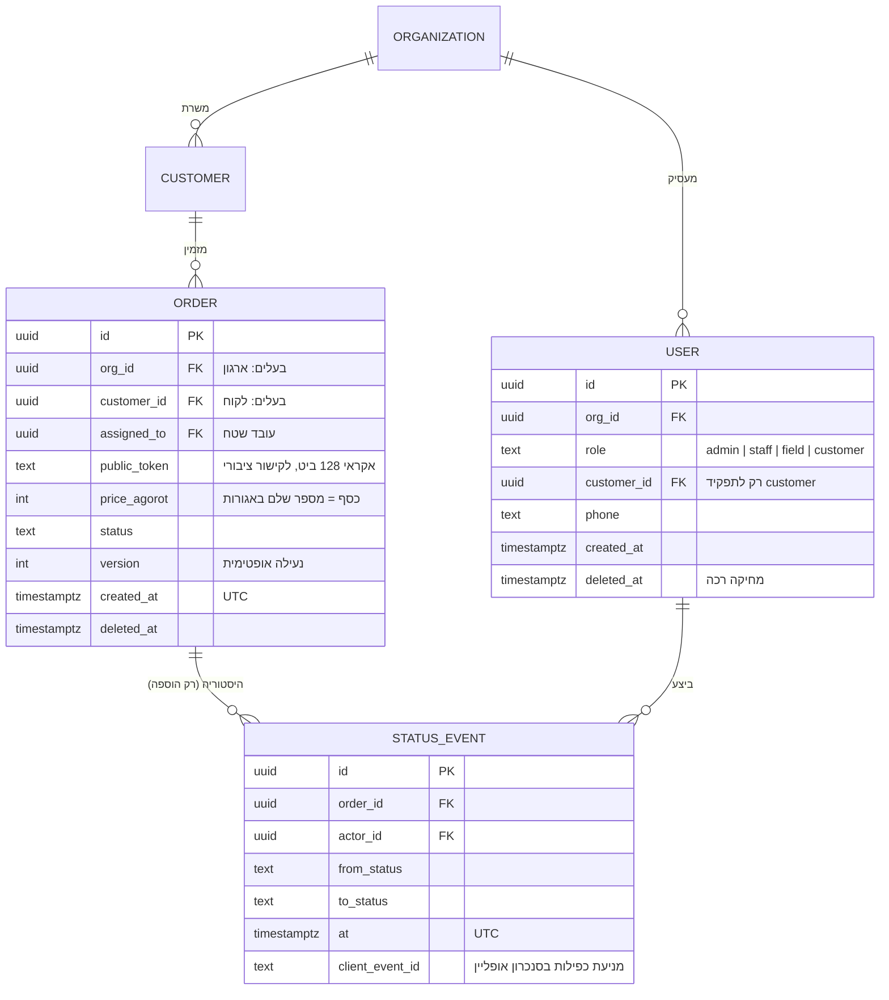
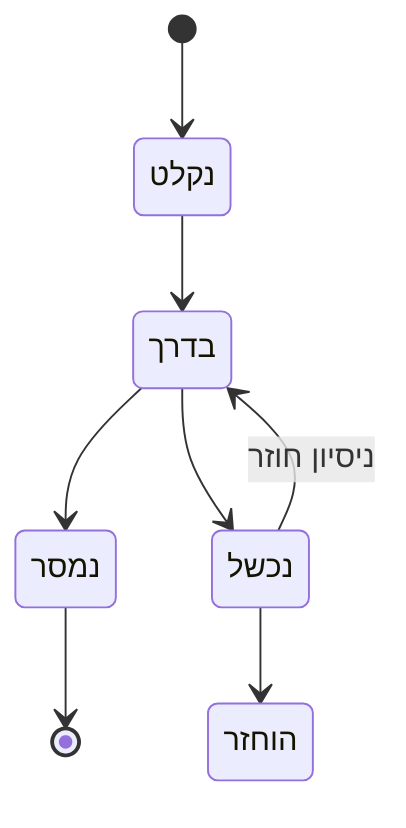

# 03 · מודל הנתונים: [שם המערכת]
> מתוכנן **לפני** הקוד, כך שיחזיק את גרסה 2 בלי שבירה. כל ישות: מי הבעלים שלה (לפי מה מסננים בהרשאות).

## תרשים (Mermaid ERD)

[להחליף את הישויות הכלליות בישויות של העסק: משלוח, נהג, אזור, תור, פריט מלאי...]

## טבלת ישויות
| ישות | שדות עיקריים | בעלים (סינון הרשאות) | מידע אישי? | נמחק? | הערות |
|---|---|---|---|---|---|
| | | `org_id` + [__] | כן / לא | מחיקה רכה | |

## מכונת מצבים (לכל ישות עם סטטוס)

**כל מכונת מצבים צריכה גם:** מצבי חריגה (חסר / תקוע / נדחה) ומי מזהה אותם, **מצב סופי לכל חריגה** (אבד, בוטל, הוחזר) ומה
הוא מפעיל (פיצוי, הודעה), **תיקון ידני** למנהל בלבד עם סיבה חובה ויומן, ותשובה ל"מה אם המשתמש מדלג על שלב".
בודקים שכל מצב שמסך ב-`08-screens.md` מציג קיים כאן, ושכל מעבר כאן מופיע ב-`04-permissions.md`.

| מעבר | מי רשאי | תנאי בשרת | נבדק בבדיקה אוטומטית |
|---|---|---|---|

## שרשרת משמורת (כשיש חפץ פיזי או כסף שעובר ידיים)
כשהכאב הוא "דברים הולכים לאיבוד", המודל חייב לענות בכל רגע על "אצל מי זה עכשיו": **סריקה בכל העברת ידיים**
(איסוף, כניסה למחסן, העמסה לנהג, מסירה, **חזרה למחסן** של מה שלא נמסר), סטטוס `חסר` עם תור חריגים, ודוח התאמה יומי
("נאסף ולא נכנס", "יצא ולא נמסר ולא חזר"). כל העברה = אירוע עם מי ומתי.

## כללים מחייבים (מסמנים ✓ לכל אחד)
- [ ] כל רשומה עסקית נושאת `org_id`, **כולל טבלאות אירועים, קבצים והודעות** (ובמערכת לכמה לקוחות: כל שאילתה מסוננת לפיו, או Row Level Security)
- [ ] כסף כמספר שלם באגורות (או `numeric`), לעולם לא float. מע"מ ושיעורים בטבלת הגדרות
- [ ] זמנים `timestamptz` ב-UTC, מוצגים ב-Asia/Jerusalem; "היום" מחושב לפי שעון ישראל
- [ ] מחיקה רכה (`deleted_at`) לנתונים עסקיים; מחיקה אמיתית רק לבקשת מחיקת מידע אישי, ומתועדת
- [ ] יומן שינויים: טבלת אירועים שרק מוסיפים לה (מי, מה, מתי, ערך קודם וחדש)
- [ ] מזהים שנחשפים בקישור ציבורי: אקראיים (UUID או 128 ביט), לא מספר רץ, **עם תפוגה**
- [ ] שיבוץ / שיוך שמשתנה נשמר כהיסטוריה (טבלה או אירוע), לא דורס את הקודם
- [ ] אילוצי ייחודיות לכל "אחד ליום / אחד לאדם" (למשל נהג + תאריך)
- [ ] מידע אישי בתוך יומנים (מיקום, טלפון) נמחק או מטושטש לפי תקופת השמירה, גם ביומן "שרק מוסיפים לו"
- [ ] זמן מהמכשיר לא אמין: שומרים גם זמן קבלה בשרת, ומסמנים פער גדול
- [ ] עדכון בו-זמני: עמודת `version` או טרנזקציה עם נעילה
- [ ] אינדקסים לשאילתות הנפוצות (לפי בעלים + תאריך + סטטוס), ונבדק עם פי 10 נתונים
- [ ] מינימום מידע אישי (אם לא צריך ת"ז, לא שומרים); תקופת שמירה מוגדרת: [__]
- [ ] מיגרציות בקוד (Prisma / Drizzle), נתוני דמו (seed) בעברית שמרימים סביבה בפקודה אחת
